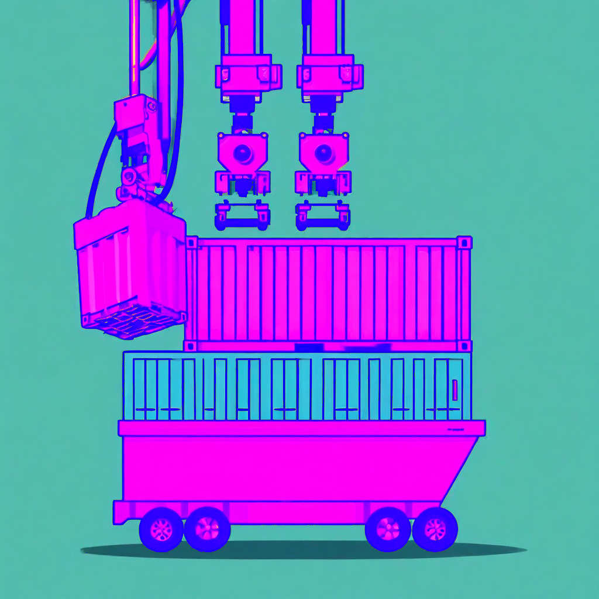

# ML Container Creator

<div align="center">
  
  <p><strong>The BYOC toolkit for Amazon SageMaker AI</strong></p>
  <p>From model selection to endpoint in one workflow. Deploy, tune, and iterate — all from one CLI.</p>
</div>

---

## Deploy a Model in 60 Seconds

```bash
# Install (or use npx @aws/ml-container-creator)
npm install -g @aws/ml-container-creator

# Generate a project
ml-container-creator my-llm \
  --deployment-config=transformers-vllm \
  --model-name=Qwen/Qwen3-4B \
  --instance-type=ml.g5.xlarge \
  --skip-prompts

# Build, deploy, and test
cd my-llm
./do/build && ./do/push && ./do/deploy && ./do/test
```

Then iterate — fine-tune and hot-swap a LoRA adapter without restarting:

```bash
./do/tune --technique sft --dataset s3://my-bucket/train.jsonl
./do/adapter add tuned-sft --from-tune
./do/test    # Verify the adapter works
```

For full control over the training code, see [Custom Training](custom-training.md) (`do/train`).

See [Getting Started](getting-started.md) for the full walkthrough with prerequisites. Upgrading from 1.x? See [Upgrading to v2](upgrading-to-v2.md).

---

## Why MCC?

Teams spend 2–5 days writing Dockerfiles, serve scripts, and deploy scripts before they can even test inference. Then they repeat that work for every model, every framework, every deployment target.

MCC eliminates the boilerplate. You select a model and a framework — MCC generates a complete, deployable project with lifecycle scripts that cover the entire iteration loop.

**You own every line of generated code.** No runtime dependency. No lock-in. MCC is a code generator, not a framework.

---

## What You Get

Every generated project includes 20+ `do/` lifecycle scripts:

| Stage | Scripts | What They Do |
|---|---|---|
| **Build** | `build`, `push`, `submit`, `stage` | Container image → Amazon ECR; model weights → S3 |
| **Deploy** | `deploy`, `add-ic`, `add-pod`, `status`, `metrics` | Model → SageMaker AI endpoint or EKS cluster |
| **Test** | `test`, `validate`, `benchmark`, `evaluate` | Inference validation, quality + performance |
| **Iterate** | `tune`, `train`, `adapter`, `draft`, `optimize` | Fine-tune, hot-swap adapters, speculative decoding, recommendations |
| **Operate** | `logs`, `clean`, `register`, `ci`, `export` | Monitoring + teardown + CI |

Every project includes 20+ scripts total. See [Deployment & Inference](deployments.md) for the full script reference.

---

## Supported Configurations

### Serving Architectures

| Architecture | Backends | Use Case |
|---|---|---|
| **Transformers** | vLLM, SGLang, TensorRT-LLM, LMI, DJL, llama.cpp | Large language models |
| **HTTP** | Flask, FastAPI | Predictive models (sklearn, XGBoost, TensorFlow) |
| **Triton** | FIL, ONNX Runtime, TensorFlow, PyTorch, vLLM, TensorRT-LLM, Python | Multi-framework serving |
| **Diffusors** | vLLM-Omni | Image generation |

### Deployment Targets

The target is chosen at deploy time: `./do/deploy --target <target>`.

| Target | Description |
|---|---|
| **Real-Time Inference** (`realtime-inference`) | SageMaker AI real-time endpoints with inference components |
| **Async Inference** (`async-inference`) | S3-based async processing with SNS notifications |
| **Batch Transform** (`batch-transform`) | S3-to-S3 dataset processing |
| **HyperPod EKS** (`hyperpod-eks`) | Kubernetes on an existing SageMaker AI HyperPod cluster (Inference Operator) |
| **Plain EKS** (`eks`) | Bring-your-own EKS cluster (Deployment + Service + ConfigMap), no operator |

### Validated Models

MCC ships a catalog of models with known-good configurations spanning generation through fine-tuning and adapter serving. Validation status per model is tracked in the [Supported Models](supported-models.md) catalog — see each entry's status.

Models NOT in the catalog still work — MCC generates projects for any HuggingFace model. You take on validation yourself.

---

## Intelligent Defaults (MCP Servers)

MCC bundles a set of [Model Context Protocol](mcp-configuration.md) servers that recommend configurations automatically. Highlights (the [MCP Servers](mcp-configuration.md) page covers every bundled server):

| Server | What It Does |
|---|---|
| **instance-sizer** | Recommends instance types from the model's size, architecture and served context |
| **region-picker** | Finds regions with availability |
| **base-image-picker** | Selects optimal base image for CUDA version |
| **model-picker** | Discovers models from HuggingFace and S3 |
| **hyperpod-cluster-picker** | Lists available HyperPod EKS clusters |
| **endpoint-picker** | Discovers existing endpoints for attachment |
| **workload-picker** | Named benchmark workload profiles for `do/benchmark --workload` |

MCP is optional — MCC works without it. MCP just makes the defaults smarter.

---

## Documentation

| Section | For... |
|---|---|
| **[Getting Started](getting-started.md)** | First-time users — install, bootstrap, deploy your first model |
| **[Upgrading to v2](upgrading-to-v2.md)** | Coming from 1.x — what changed and how to migrate |
| **[Supported Models](supported-models.md)** | Check if your model is validated end-to-end |
| **[Configuration](configuration.md)** | CLI flags, env vars, config files, MCP, precedence |
| **[Deployment & Inference](deployments.md)** | All deployment targets + full lifecycle scripts reference |
| **[Bootstrap](bootstrap.md)** | One-time AWS infrastructure (modular CDK stacks) |
| **[Secrets](secrets.md)** | Hugging Face / NGC tokens in AWS Secrets Manager |
| **[Fine-Tuning](fine-tuning.md)** | Managed tuning, LoRA adapters, the iterate loop |
| **[Custom Training](custom-training.md)** | Your own training code with `do/train` |
| **[Scale-to-Zero](scale-to-zero.md)** | Idle real-time endpoints scaled to zero instances |
| **[MCP Servers](mcp-configuration.md)** | Configure and extend the intelligent defaults |
| **[CI Integration](ci-integration.md)** | Automated E2E validation + regression detection |
| **[Benchmarking](benchmarking.md)** | Performance measurement with SageMaker AI Benchmarking |
| **[Examples](EXAMPLES.md)** | Copy-paste walkthroughs for every architecture |
| **[Troubleshooting](TROUBLESHOOTING.md)** | Common issues and solutions |
| **[Contributing](CONTRIBUTING.md)** | Development setup + contribution workflow |
| **[Command Generator](command-generator.md)** | Interactive tool to build deployment commands |

---

## Links

- [GitHub Repository](https://github.com/awslabs/ml-container-creator)
- [npm Package](https://www.npmjs.com/package/@aws/ml-container-creator)
- [Report an Issue](https://github.com/awslabs/ml-container-creator/issues)
- [Discussions](https://github.com/awslabs/ml-container-creator/discussions)

---

## License

Apache-2.0. See [CONTRIBUTING](https://github.com/awslabs/ml-container-creator/blob/main/CONTRIBUTING.md#security-issue-notifications) for security issue reporting.
